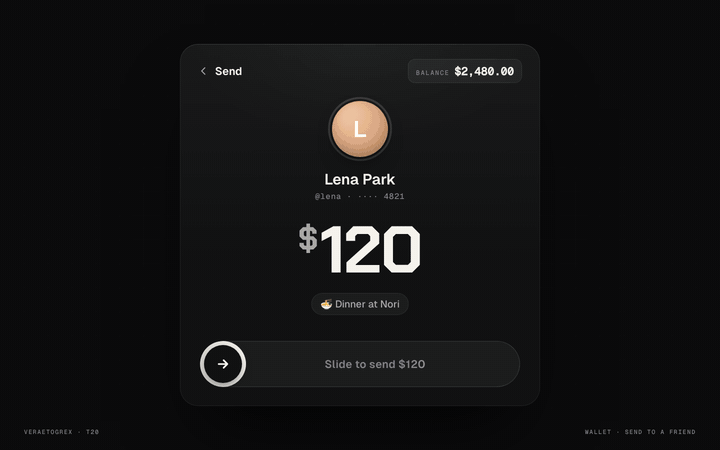

# Send Money

**Slide to send. The receipt prints itself.**



**Live demo:** [veraetogrex-portfolio.github.io/send-money](https://veraetogrex-portfolio.github.io/send-money/) · **Mockup:** [full-screen version](https://veraetogrex-portfolio.github.io/send-money/mockup/send-money.html)

Slide to send. The amount turns into a coin and flies to your friend, the ring around their photo closes, they say thanks, and the slider melts into a slot that prints the receipt.

## Use it

Three files, no build step, no dependencies, no web fonts:

```
index.html   markup
style.css    styles and keyframes
script.js    behaviour
```

Download the repo and open `index.html`, or copy the three files into your project.

## Try it

- Drag the slider all the way right (or focus it and press Enter). Let go early and it springs back.
- After the receipt is torn off, reload or press R in the mockup to send again.

## Make it yours

`AMOUNT` and `BALANCE` at the top of `script.js` set the transfer; names, note and receipt lines are plain HTML in `index.html`.

## What's in `mockup/`

The full 1440×900 screen this component was shot in for the reel:

- `mockup/send-money.html` — interactive. `D` plays the demo, `R` resets.
- `mockup/send-money.autoplay.html` — the scripted loop the reel was recorded from.
- URL flags: `?frame` puts the screen in a browser window, `?clean` hides the control panel, `?once` plays the demo once.

The mockup loads the same `style.css` and `script.js` from the root, plus a shared stage runtime and bundled fonts from `mockup/_shared/`. The component in the root doesn't need any of it.

---

Component 20 of a series. New one every day on Instagram [@veraetogrex_portfolio](https://www.instagram.com/veraetogrex_portfolio/) · all components: [github.com/veraetogrex-portfolio](https://github.com/veraetogrex-portfolio)

MIT licensed.
